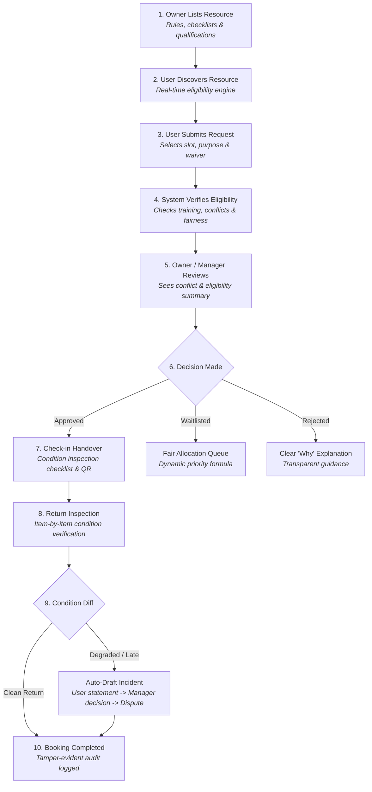
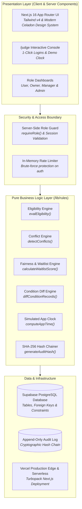
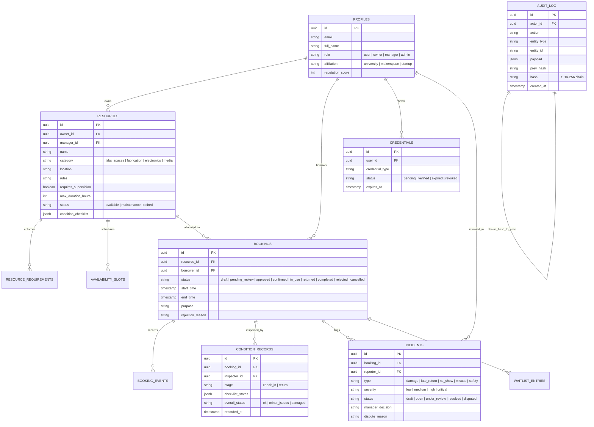

# CampusShare — University & Makerspace Resource Sharing Network

> **Unlock underused equipment and spaces, safely, fairly, and accountably.**

[](https://campus-share-rose.vercel.app)
[](https://campus-share-rose.vercel.app/judge)
[](https://github.com/m-sohel/campus-share)
[](https://nextjs.org/)
[](https://tailwindcss.com/)
[](https://supabase.com/)

---

## 🌐 Live Application & Judge Links

- **Production URL:** [https://campus-share-rose.vercel.app](https://campus-share-rose.vercel.app)
- **Interactive Judge Experience:** [https://campus-share-rose.vercel.app/judge](https://campus-share-rose.vercel.app/judge)
- **Repository:** [https://github.com/m-sohel/campus-share](https://github.com/m-sohel/campus-share)

> **Quick Evaluation for Judges:** Open the `/judge` page for one-click instant logins as any seeded role (Owner, Manager, User, Admin), a step-by-step interactive lifecycle walkthrough script, a live Demo Clock to simulate time travel (+1 hour / +24 hours), and a one-click safe demo data reset button.

---

## 📌 Table of Contents

1. [Executive Summary & Problem Statement](#-executive-summary--problem-statement)
2. [Target Users & Focused Use Case](#-target-users--focused-use-case)
3. [The 10-Step Booking Lifecycle](#-the-10-step-booking-lifecycle)
4. [System Architecture](#-system-architecture)
5. [Database Schema & Data Model](#-database-schema--data-model)
6. [Core Rule Engines & Technical Innovations](#-core-rule-engines--technical-innovations)
7. [Design System & UI/UX Polish](#-design-system--uiux-polish)
8. [Judge Evaluation Guide & Seeded Personas](#-judge-evaluation-guide--seeded-personas)
9. [Local Setup & Development](#-local-setup--development)
10. [Automated Testing Suite](#-automated-testing-suite)
11. [Security, Privacy & Fairness Principles](#-security-privacy--fairness-principles)
12. [Completed Stages vs. Roadmap](#-completed-stages-vs-roadmap)
13. [Mandatory Disclosure & Attribution](#-mandatory-disclosure--attribution)

---

## 💡 Executive Summary & Problem Statement

### The Problem
Universities and community makerspaces own millions of dollars in specialized, high-value resources: cleanroom photolithography labs, fiber laser cutters, high-bandwidth digital oscilloscopes, cinema camera packages, and rapid prototyping workstations.

However:
- **Equipment sits idle** up to 70% of the time behind institutional gatekeeping.
- **Undergrads, researchers, and bootstrap startups** cannot afford commercial access.
- **Standard booking calendars** (e.g., Google Calendar, Calendly) fail catastrophically because they assume **zero friction and zero risk**: they cannot verify safety qualifications, cannot check credential expiry, have no physical condition verification, ignore usage fairness, and cannot resolve damage disputes.

### The Solution: CampusShare
**CampusShare** is a production-grade, multi-tenant resource sharing platform tailored specifically to university departments and community makerspaces. It replaces blind scheduling with **trust, safety, and accountability**:
- **Prerequisite Eligibility Engine:** Verifies certifications, training, and credential expiration before booking requests can even be lodged.
- **Fair-Share Priority Waitlist:** Mathematically balances demand using waiting time, 30-day historical usage, and project deadlines to prevent resource monopolization.
- **Physical Condition Inspection & Diffing:** Mandatory mobile-first checklists at physical handover and return that automatically compute condition degradation.
- **Human-in-the-Loop Due Process:** Automated draft incident flagging with transparent user responses, manager adjudication, and administrative dispute resolution.
- **Cryptographic SHA-256 Audit Chain:** Tamper-evident, append-only ledger of every critical state change, verifiable by governance administrators on demand.

---

## 👥 Target Users & Focused Use Case

### Focused Use Case
A cross-institutional partnership between **Apex University Engineering Campus** and the **Downtown Community Makerspace Guild**.

### Categories
1. **Labs & Spaces:** Cleanroom Microfabrication Bay, Modular Showcase & Pitch Conference Room.
2. **Fabrication Equipment:** Formlabs Form 4 SLA Resin Printer, Kern 100W Industrial CO2 Laser Cutter.
3. **Electronics & Test Devices:** Keysight InfiniiVision 4-Channel 1GHz Digital Oscilloscope, High-Temp Reflow Station.
4. **Media & Camera Gear:** Sony FX6 Cinema Camera Package, DJI Inspire 3 Commercial Cinema Drone Kit.

### Roles & Responsibilities
- **Borrower / User:** Discovers assets, tracks eligibility requirements, submits booking requests, completes check-in/return checklists, and files appeals if disputes arise.
- **Resource Owner:** Faculty directors and guild leads who list equipment, define availability slots, configure prerequisite qualifications, and approve reservations.
- **Station Manager / Technician:** Delegated lab technicians who conduct physical check-in handovers, inspect returned equipment, verify condition diffs, and review draft incidents.
- **Governance Admin:** Department directors who verify training credentials, adjust campus-wide fairness policies, arbitrate unresolved user disputes, and audit cryptographic log integrity.

---

## 🔄 The 10-Step Booking Lifecycle

A judge or evaluator can complete the entire 10-step lifecycle using seeded accounts in under 5 minutes:



1. **Owner Lists Resource:** Owner creates equipment with location, safety instructions, prerequisite credentials, duration limits, and an itemized condition checklist. A "Listing Completeness" meter guides publication.
2. **User Discovers Resource:** User searches and filters the catalog. The eligibility engine computes personal eligibility in real-time, giving actionable fix links for missing or expired requirements.
3. **Booking Request:** User selects an available slot, enters team size and purpose, and digitally signs the safety waiver.
4. **Automated Verification:** System checks qualifications, validates blackout dates, and checks for conflicting bookings.
5. **Manager Review:** Owner or technician evaluates the request in their approval inbox.
6. **Transparent Decision:** If approved, rejected, or waitlisted, a human-readable **"Why was my request decided this way?"** card is attached to the request.
7. **Mobile Check-in Handover:** Manager conducts physical check-in, inspecting each checklist item (`OK`, `Minor Issue`, `Damaged`) and recording notes. Status moves to `In Use`.
8. **Return Inspection:** Manager inspects the returned equipment against the baseline checklist.
9. **Condition Diff & Incident Handling:** Pure rule engine calculates whether any item deteriorated. If degraded or late, the system auto-drafts an incident for human review. The borrower can submit a response, the manager makes a ruling, and disputes can be escalated to the campus admin.
10. **Immutable History & Timeline:** Both parties view the unified, chronological booking event timeline, backed by an immutable SHA-256 cryptographic audit chain.

---

## 🏗️ System Architecture

CampusShare is architected with strict separation of concerns, ensuring that pure business logic remains testable, decoupled, and isolated from UI and transport layers:



---

## 🗄️ Database Schema & Data Model

The database is built on PostgreSQL (hosted via Supabase) with strict foreign keys, integrity constraints, and append-only audit enforcement:



---

## ⚙️ Core Rule Engines & Technical Innovations

### 1. Pure Eligibility Engine (`/src/lib/rules/eligibility.ts`)
Evaluates eligibility for any user against any resource without side effects.
- Categorizes status: `pass`, `fail`, `expired`, or `pending-verification`.
- Emits plain-language explanations with actionable fix URLs (e.g., direct links to submit a training request).
- Distinguishes between **mandatory** requirements (which block booking) and **recommended** qualifications.

### 2. Condition Inspection & Diffing Engine (`/src/lib/rules/condition.ts`)
Compares baseline handover condition records against return condition records:
- Detects transitions from `OK` to `Minor Issue` or `Damaged`.
- Recommends appropriate incident severities (`low`, `medium`, `high`).
- Evaluates late returns (15-minute grace period threshold).
- Automatically suggests creating an incident in `Draft` status for human review — **never penalizes users automatically**.

### 3. Fair-Share Allocation & Dynamic Waitlist (`/src/lib/rules/fairness.ts`)
Prevents resource hoarding on high-demand equipment using an equitable scoring algorithm:

$$\text{Priority Score} = (\text{Wait Hours} \times 2.0) - (\text{30-Day Usage Hours} \times 3.0) + \text{Deadline Bonus} - (\text{Penalty Strikes} \times 15.0)$$

- **Usage vs. Quota:** Users track their consumption via the in-app **Fair Use Meter**.
- **Transparency:** The complete breakdown of each factor is visible to both the applicant and the manager.
- **Auto-Promotion:** If an approved reservation is cancelled, the top-ranked waitlisted user is offered the slot with an acceptance countdown window.

### 4. Cryptographic SHA-256 Audit Trail (`/src/lib/rules/audit.ts`)
Every security-sensitive state transition writes to an append-only ledger:
- Each entry stores $\text{hash} = \text{SHA-256}(\text{previous\_hash} + \text{canonical\_json}(\text{entry\_data}))$.
- An administrative verification engine (`/src/lib/rules/audit-verifier.ts`) recalculates the entire chain on demand, detecting any external database tampering or record manipulation.

### 5. Simulated App Clock ("Time Machine") (`/src/lib/rules/clock.ts`)
To allow judges to test time-based workflows without waiting hours in real time:
- Administrators can advance simulated time by **+1 Hour** or **+24 Hours** via the Judge console or Admin dashboard.
- Evaluates overdue return detections, upcoming reservation reminders, and waitlist offer expirations dynamically against simulated clock time.
- Safe reset button returns the clock instantly to real time.

---

## 🎨 Design System & UI/UX Polish

CampusShare features a tailored, accessible design system specifically created for academic and makerspace workflows:

- **Earthy, Natural Palette:**
  - **Celadon & Vibrant Greens (`#407524` / `#6bc33c`):** Trust, clearance, verified status, and primary call-to-actions.
  - **Tea Green (`#cdefa9` / `#e6f7d4`):** Active badges, focus rings, and selection accents.
  - **Soft Celadon (`#eff6ef` / `#dfecdf`):** Card surfaces, sidebars, and soft containers.
  - **Dusty Olive (`#f3f4f0` / `#515742`):** Body typography, borders, and structural framing.
  - **Muted Teal (`#5ca396` / `#37625a`):** Secondary controls, metadata, and tags.
- **Responsive & Mobile-First:** Handover checklists and QR check-in flows are optimized for handheld use by technicians standing at equipment benches.
- **Zero Placeholder Guarantee:** Every button, filter, dropdown, and modal has active functional logic with zero dead links or "coming soon" placeholders.

---

## 🧑‍⚖️ Judge Evaluation Guide & Seeded Personas

Judges can complete a full journey in under 5 minutes without setup by visiting **[`/judge`](https://campus-share-rose.vercel.app/judge)**.

### Seeded Demo Accounts (Password for all: `Password123!`)

| Persona | Role | Email | Best For Testing |
| :--- | :--- | :--- | :--- |
| **Dr. Arthur Vance** | `admin` | `admin@campusshare.edu` | Audit chain verification, demo clock fast-forward, dispute arbitration. |
| **Prof. Elena Rostova** | `owner` | `owner.lab@campusshare.edu` | Resource creation, availability management, request approval inbox. |
| **Jordan Taylor** | `manager` | `manager.tech@campusshare.edu` | Mobile QR check-in, condition inspection, draft incident decisions. |
| **Sarah Jenkins** | `user` | `user.researcher@campusshare.edu` | Fully certified researcher; instant eligibility on advanced equipment. |
| **Liam Patel** | `user` | `user.expired@campusshare.edu` | Student with expired laser safety certification; tests fix-it flows. |
| **Amara Okafor** | `user` | `user.pending@campusshare.edu` | Media student with training pending verification by staff. |
| **David Kim** | `user` | `user.startup@campusshare.edu` | Incubator founder; tests fairness quotas and waitlist priority scoring. |

### 5-Minute Judge Script
1. **Visit `/judge`:** Click **"Log in as Sarah Jenkins (User)"** and explore the Catalog. Notice instant eligibility on the Kern 100W Laser Cutter.
2. **Submit a Booking:** Book an open afternoon slot and confirm the safety waiver.
3. **Switch to Owner:** Use the top bar or `/judge` to switch to **Prof. Elena Rostova (Owner)**. Open the Request Inbox, view the "Why" analysis, and click **Approve**.
4. **Conduct Check-in:** Log in as **Jordan Taylor (Manager)**. Open the booking check-in screen, mark all checklist items as `OK`, and confirm handover.
5. **Simulate Damage & Return:** Perform the return inspection and toggle one item (e.g., lens) to `Damaged`. Notice the side-by-side **Condition Diff** highlighting the change and drafting an incident.
6. **Time Travel:** Log in as **Dr. Arthur Vance (Admin)**. Click **"+24 Hours"** on the Demo Clock to trigger overdue notifications and verify the unbroken SHA-256 audit ledger.

---

## 💻 Local Setup & Development

### Prerequisites
- **Node.js:** v20.x or higher
- **npm:** v10.x or higher
- **Git**

### Installation Steps

1. **Clone the Repository:**
   ```bash
   git clone https://github.com/m-sohel/campus-share.git
   cd campus-share
   ```

2. **Install Dependencies:**
   ```bash
   npm install
   ```

3. **Configure Environment Variables:**
   Copy `.env.example` to `.env.local` and configure your Supabase project keys:
   ```bash
   cp .env.example .env.local
   ```

4. **Run Database Migrations (Supabase):**
   Execute the migration scripts in `supabase/migrations/` in order:
   - `001_initial_schema.sql`
   - `002_booking_workflow.sql`
   - `003_audit_trail_append_only.sql`
   - `004_fairness_and_waitlist.sql`

5. **Seed Demo Data:**
   ```bash
   npm run seed
   ```

6. **Start Local Development Server:**
   ```bash
   npm run dev
   ```
   Open [http://localhost:3005](http://localhost:3005) in your browser.

---

## 🧪 Automated Testing Suite

CampusShare features a comprehensive automated test harness covering all pure rule engines and multi-stage end-to-end integration workflows.

To run the complete test suite:
```bash
npm test
```

### Test Coverage Summary (100% Passing)

```text
==================================================
🧪 Stage 2: Eligibility Engine Pure Unit Tests (21/21 passed)
🚀 Stage 2: End-to-End Workflow Verification   (12/12 passed)
🧪 Condition Engine & Diff Unit Tests          (19/19 passed)
🚀 Stage 4: Check-in, Return & Diff E2E Tests  (16/16 passed)
🚀 Stage 6: Judge Experience & Dashboards E2E  (18/18 passed)
🧪 Stage 8: Incidents & Disputes Rule Tests    (19/19 passed)
🧪 Stage 8: App Clock & Time-Based Logic Tests (14/14 passed)
🚀 Stage 8: Incidents & Due Process E2E Tests  (34/34 passed)
==================================================
Total: 153 Tests Passing | 0 Failures
```

Individual test suites can be executed with:
```bash
npm run test:condition   # Condition inspection and diff rules
npm run test:stage4      # Handover, return and draft incidents
npm run test:stage6      # Dashboards, judge script, and seed integrity
npm run test:stage8      # Incidents, dispute appeals, and time travel
```

---

## 🔒 Security, Privacy & Fairness Principles

- **Server-Side Authorization:** Every action checks permissions via `requireRole()` and validates actor identity against resource ownership; UI controls are never the sole line of defense.
- **Append-Only Tamper-Evident Ledger:** Audit entries cannot be modified or deleted. Each entry cryptographically hashes the previous entry using SHA-256, enabling immediate detection of data corruption or tampering.
- **Zero Automated Penalties:** The system automatically drafts incidents for review, but never charges fees, revokes access, or bans users without explicit human review and dispute due process.
- **Transparent "Why" Explanations:** Rejections, waitlist placements, and approval decisions always display an understandable, plain-language justification.
- **Anti-Monopolization Limits:** Configurable weekly limits and cooldown periods prevent single labs or corporate affiliates from reserving all available slots.
- **Rate-Limiting Protection:** In-memory sliding window rate limiters protect authentication and sensitive API endpoints against automated brute-force attacks.

---

## 📊 Completed Stages vs. Roadmap

| Stage / Component | Scope & Objective | Status |
| :--- | :--- | :---: |
| **Stage 1: Foundation** | Schema, Supabase migrations, auth, RBAC guards, seed data, Vercel deploy | ✅ Complete |
| **Stage 2: Discovery & Eligibility** | Catalog, filters, completeness meter, pure eligibility engine, credential queue | ✅ Complete |
| **Stage 3: Bookings & Conflicts** | Slot selection, conflict detection, double-booking prevention, "Why" explanations | ✅ Complete |
| **Stage 4: Check-in & Return** | Mobile condition inspection checklists, pure diff engine, draft incidents, QR codes | ✅ Complete |
| **Stage 5: Auditable History** | Append-only ledger, SHA-256 cryptographic chaining, chronological event timeline | ✅ Complete |
| **Stage 6: Judge Experience** | Public `/judge` portal, 1-click role logins, 10-step guided script, role dashboards | ✅ Complete |
| **Stage 7: Fair Allocation** | Priority waitlist formula, Fair Use meter, auto-offer on cancellation, admin quotas | ✅ Complete |
| **Stage 8: Incidents & Due Process** | Damage/late incident workflow, user statements, disputes, demo time machine | ✅ Complete |
| **Stage 9: AI Assistance (Stretch)** | Smart natural-language search, AI draft incident summaries (human-reviewed) | 🔄 Roadmap |
| **Stage 10: Final Quality & Polish** | Full responsive audit, WCAG AA contrast check, comprehensive documentation | ✅ Complete |

---

## 📜 Mandatory Disclosure & Attribution

In accordance with hackathon guidelines, all third-party libraries, templates, and artificial intelligence tools used during development are transparently disclosed:

### Core Frameworks & Libraries
- **Frontend & Fullstack:** [Next.js 16](https://nextjs.org/) (App Router, Server Actions, Turbopack), [React 19](https://react.dev/), [TypeScript](https://www.typescriptlang.org/)
- **Styling & Components:** [Tailwind CSS v4](https://tailwindcss.com/), [Lucide React](https://lucide.dev/) (icons), `clsx`, `tailwind-merge`
- **Database & Authentication:** [Supabase](https://supabase.com/) (`@supabase/supabase-js`, `@supabase/ssr`, PostgreSQL 15)
- **Utilities:** `date-fns` (time calculations), `qrcode` (QR code generation), `zod` (runtime schema validation)

### Artificial Intelligence & Pair Programming
- **AI Coding Assistant:** Developed in collaboration with **Google Antigravity** (DeepMind Advanced Agentic Coding team) utilizing paired reasoning for code refactoring, pure business logic test suites, and UI component styling.
- **Design System Implementation:** Color tokens, accessible contrast scales, and responsive layout polish implemented according to strict human-directed UI/UX specifications.

### Team Responsibilities
- **Kasim Shah:** Backend architecture, Supabase database schema and migrations, pure business rule engines (`/lib/rules/`), waitlist scoring formulas, cryptographic SHA-256 audit chaining, and server-side RBAC guards.
- **Shaikh Sohel:** Frontend architecture, Next.js App Router UI, responsive design system and styling overhaul, component state machines, interactive `/judge` portal, condition inspection checklists, and end-to-end integration flows.

---

*Built with ❤️ for universities, research communities, and makerspaces everywhere.*
