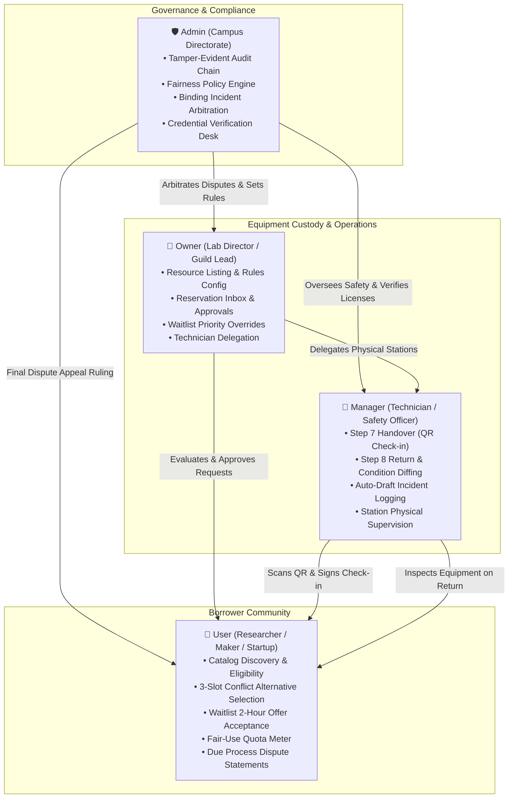
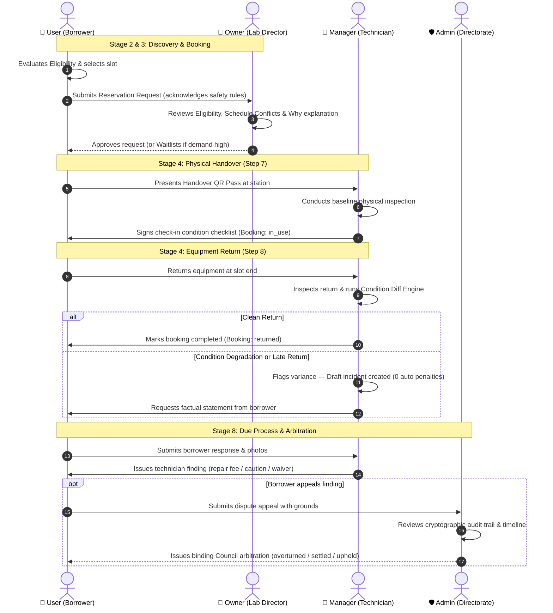
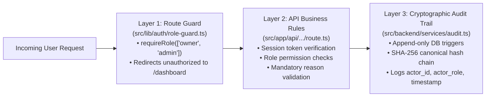

# CampusShare — Role-Based Access Control (RBAC) Architecture

This document defines the complete **Role-Based Access Control (RBAC)** architecture, responsibilities matrix, security enforcement layers, and persona mappings in **CampusShare**.

CampusShare enforces strict separation of concerns across university laboratories, community makerspaces, and hardware incubators to ensure safety compliance, fair allocation, physical equipment custody, and tamper-proof audit trails.

---

## 1. Visual RBAC Architecture

### 1.1 Role Hierarchy & Domain Responsibilities



---

### 1.2 End-to-End Workflow Across Roles



---

### 1.3 Triple-Layer Security Enforcement Model



---

## 2. Core RBAC Roles Breakdown

CampusShare defines four core roles:

```typescript
export type UserRole = "user" | "owner" | "manager" | "admin";
```

### 2.1 Role 1: `user` — Borrower / Researcher / Maker
The borrower role represents students, academic researchers, community makers, and incubator startups requesting access to campus resources.

- **Primary Mission:** Discover equipment, verify prerequisites, reserve timeslots, present QR passes for handover, and responsibly use resources within fair-share quotas.
- **Seeded Personas:**
  - **Sarah Jenkins:** Fully-qualified postdoctoral robotics researcher.
  - **David Kim:** Hardware startup incubation fellow.
  - **Liam Patel:** Aerospace student with expired safety training.
  - **Amara Okafor:** Media design student with pending camera credentials.
  - **Zoe Martinez:** Newcomer student with zero certifications.
  - **Lucas Wright:** Borrower with past incident history and revoked access.
- **Key Responsibilities:**
  1. **Prerequisite Compliance:** Review prerequisites before booking and submit license/training endorsements via `/credentials/request`.
  2. **Rule Acknowledgment:** Digitally acknowledge operating procedures, safety rules, and cleanup obligations on every booking request.
  3. **Schedule Conflict Resolution:** Pick one of 3 suggested nearest free slots if requested slot collides with existing bookings or blackout dates.
  4. **Waitlist & Acceptance Window:** When joining high-demand queues, monitor position transparently; respond to vacated slot offers within the mandatory **2-hour window**.
  5. **Handover Presentation:** Present digital QR passes to station technicians during Step 7 check-in.
  6. **Due Process Participation:** In case of damage or late returns, submit factual statements and appeal decisions before administrative arbitration.

---

### 2.2 Role 2: `owner` — Equipment & Lab Custodian
The owner role represents department heads, laboratory directors, and makerspace guild leads who own, fund, and curate high-value tools.

- **Primary Mission:** Govern resource availability, define safety requirements, review booking requests with transparent explanations, and manage queue priorities.
- **Seeded Personas:**
  - **Prof. Elena Rostova:** University Lab Director (Electrical & Computer Engineering).
  - **Marcus Chen:** Makerspace Guild Lead (Downtown Community Makerspace).
- **Key Responsibilities:**
  1. **Listing Management:** Create (`/resources/new`) and edit (`/resources/[id]/edit`) resource specifications, safety checklists, lead times, and mandatory credentials.
  2. **Reservation Inbox Decisioning:** Review incoming booking applications on the Owner Dashboard (`/dashboard/owner`). Available actions:
     - `Approve`: Confirms slot availability and grants permission.
     - `Reject`: Declines request; **substantive explanation is strictly required**.
     - `Waitlist`: Places requester in fair-share queue; **explanation is strictly required**.
  3. **Waitlist Oversight & Owner Override:** Inspect multi-factor priority scores (usage, wait time, deadlines, strikes). Owners can **override priority** with a mandatory audited justification.
  4. **Technician Delegation:** Assign operational technicians/managers to supervised benches.
  5. **Capacity Monitoring:** Track utilization percentages and fair-share capacity across benches.

---

### 2.3 Role 3: `manager` — Facility Technician & Safety Officer
The manager role represents laboratory technicians, workshop assistants, and safety marshals responsible for day-to-day bench operations.

- **Primary Mission:** Supervise the physical check-in/return loop (Steps 7 & 8), execute condition checklist diffs, and ensure zero automated penalties occur without human technical inspection.
- **Seeded Persona:**
  - **Jordan Taylor:** Makerspace Safety & Equipment Operations Technician.
  - Also includes assigned lab staff and secondary safety supervisors.
- **Key Responsibilities:**
  1. **Physical Check-in Handover (Step 7):** Verify borrower digital QR passes at the station and execute baseline condition checklists (`/bookings/[id]/check-in`).
  2. **Return Inspection & Diffing (Step 8):** Inspect returned tools (`/bookings/[id]/return`) against baseline checklists. The pure condition engine computes wear/damage diffs.
  3. **Draft Incident Generation:** If wear, damage, or late return is detected, the technician automatically creates a `draft` incident for review. **No automated fines or bans are ever applied.**
  4. **Initial Adjudication:** Review borrower response statements, inspect physical items, and issue technician determinations (`fault_equipment`, `operator_negligence`, `minor_wear_waived`).
  5. **Delegated Approvals:** Review and decide reservation requests delegated by resource owners.

---

### 2.4 Role 4: `admin` — Campus Directorate & Governance Council
The admin role represents university safety directors, deans of facilities, and campus innovation councils who exercise ultimate governance.

- **Primary Mission:** Guarantee platform integrity, verify qualification certificates, enforce anti-monopoly fairness policies, and provide binding dispute arbitration.
- **Seeded Persona:**
  - **Dr. Arthur Vance:** Campus Innovation & Safety Directorate Council Chair.
- **Key Responsibilities:**
  1. **Cryptographic Audit Trail Verification:** Supervise the append-only audit trail (`/dashboard/admin`). Use the **"Verify Integrity"** engine to recompute SHA-256 hash chains and detect tampering down to the exact block.
  2. **System-wide Fairness Policy Tuning:** Configure fairness thresholds via `FairnessSettingsForm` (max active bookings per user, weekly category quotas, and anti-monopoly cooldown hours).
  3. **Qualification Verification Desk:** Inspect borrower safety training submissions and license proofs (`/credentials/verify`); approve or reject credentials.
  4. **Binding Incident Arbitration:** Handle contested technician determinations and borrower dispute appeals (`/incidents/[id]`). Issue final Council rulings:
     - `overturned`: Clears borrower record and waives all claims.
     - `settled_reduced`: Adjusts repair costs based on institutional shared liability.
     - `upheld_sanction`: Affirms technician findings and applies administrative caution.
  5. **System Governance:** View all 10 verified personas, system health indicators, and platform-wide capacity statistics.

---

## 3. Institutional Affiliations (`affiliation`)

In addition to RBAC roles, each user belongs to one of three institutional affiliations:

| Affiliation | Description | Target Use Case | Example Resources |
|---|---|---|---|
| `university` | Academic students, researchers, faculty | Degree projects, sponsored scientific research, thesis experiments | Cleanrooms, Class 4 Lasers, High-speed oscilloscopes |
| `makerspace` | Community guild members, hobbyists, artisans | Prototyping, woodwork, metalwork, creative media production | 3D printers, CNC routers, podcast broadcast kits |
| `startup` | Early-stage hardware incubator fellows | Seed-funded hardware MVP development, product validation | Specialized test benches, fabrication tools |

---

## 4. Permissions & Capabilities Matrix

| Capability / Feature | `user` | `owner` | `manager` | `admin` | Enforcement Location |
|---|:---:|:---:|:---:|:---:|---|
| **Browse Resource Catalog** | ✅ | ✅ | ✅ | ✅ | Public Route (`/resources`) |
| **Check Live Eligibility** | ✅ | ✅ | ✅ | ✅ | `/lib/rules/eligibility.ts` |
| **Submit Booking Request** | ✅ | ✅ | ✅ | ✅ | `/api/bookings` |
| **Review / Decide Requests** | ❌ | ✅ | ✅ *(delegated)* | ✅ | `requireRole(["owner", "manager", "admin"])` |
| **Mandatory Reason on Reject** | N/A | ✅ | ✅ | ✅ | Backend Service validation |
| **Join Waitlist Queue** | ✅ | ✅ | ✅ | ✅ | `/api/waitlist` |
| **Override Waitlist Priority** | ❌ | ✅ *(owned)* | ❌ | ✅ | `requireRole(["owner", "admin"])` |
| **Configure Fairness Settings** | ❌ | ❌ | ❌ | ✅ | `requireRole(["admin"])` |
| **Execute Check-in (Step 7)** | ❌ | ✅ | ✅ | ✅ | `requireRole(["manager", "owner", "admin"])` |
| **Execute Return Diff (Step 8)**| ❌ | ✅ | ✅ | ✅ | `requireRole(["manager", "owner", "admin"])` |
| **Create Incident Report** | ❌ | ✅ | ✅ | ✅ | `requireRole(["manager", "owner", "admin"])` |
| **Submit Dispute Statement** | ✅ *(affected)*| ❌ | ❌ | ❌ | User Ownership check |
| **Issue Technician Decision** | ❌ | ✅ | ✅ | ✅ | `requireRole(["manager", "admin"])` |
| **Arbitrate Contested Dispute** | ❌ | ❌ | ❌ | ✅ | `requireRole(["admin"])` strictly |
| **Verify Audit Hash Chain** | ❌ | ❌ | ❌ | ✅ | `requireRole(["admin"])` |
| **Approve User Qualifications**| ❌ | ❌ | ❌ | ✅ | `requireRole(["admin"])` |

---

## 5. Implementation in Codebase

### 5.1 Route-Level Role Guards
Defined in [`src/lib/auth/role-guard.ts`](../src/lib/auth/role-guard.ts):

```typescript
// Enforce role permission on server components
export async function requireRole(allowedRoles: UserRole[]): Promise<Profile> {
  const user = await getCurrentUser();

  if (!user) {
    redirect("/login?error=auth_required");
  }

  if (!allowedRoles.includes(user.role)) {
    redirect(`/dashboard/${user.role}?error=unauthorized_role_access`);
  }

  return user;
}
```

### 5.2 API-Level Security Checks
Every API endpoint validates that the calling actor has proper role authorization:

```typescript
// Example: src/app/api/bookings/[id]/review/route.ts
if (user.role !== "owner" && user.role !== "manager" && user.role !== "admin") {
  return NextResponse.json(
    { error: "Forbidden: Only resource owners and technicians can review requests." },
    { status: 403 }
  );
}
```

### 5.3 Cryptographic Audit Trail
All state transitions log immutable events via [`src/backend/services/audit.ts`](../src/backend/services/audit.ts):

```typescript
await logAuditEvent({
  actorId: user.id,
  actorRole: user.role,
  action: "BOOKING_APPROVED",
  resourceType: "booking",
  resourceId: bookingId,
  reason: "Approved after research verification.",
});
```

---

## 6. Seeded Personas Quick Reference

| Email | Password | Full Name | Role | Department & Affiliation |
|---|---|---|:---:|---|
| `admin@campusshare.edu` | `Password123!` | Dr. Arthur Vance | **admin** | Campus Safety Directorate (`university`) |
| `owner.lab@campusshare.edu` | `Password123!` | Prof. Elena Rostova | **owner** | Dept of Electrical Engineering (`university`) |
| `owner.makerspace@campusshare.edu` | `Password123!` | Marcus Chen | **owner** | Downtown Makerspace Guild (`makerspace`) |
| `manager.tech@campusshare.edu` | `Password123!` | Jordan Taylor | **manager** | Makerspace Safety Operations (`makerspace`) |
| `user.researcher@campusshare.edu` | `Password123!` | Sarah Jenkins | **user** | Robotics Lab (`university`) |
| `user.expired@campusshare.edu` | `Password123!` | Liam Patel | **user** | Aerospace Engineering (`university`) |
| `user.pending@campusshare.edu` | `Password123!` | Amara Okafor | **user** | Interactive Media & Design (`university`) |
| `user.startup@campusshare.edu` | `Password123!` | David Kim | **user** | NeuroTech Incubation Fellow (`startup`) |
| `user.new@campusshare.edu` | `Password123!` | Zoe Martinez | **user** | Undergraduate Design Studio (`university`) |
| `user.revoked@campusshare.edu` | `Password123!` | Lucas Wright | **user** | Drone Racing Club (`university`) |

To evaluate any persona instantaneously, use the **1-Click Persona Switcher** on the [Login Page](/login) or the [Judge Evaluation Console](/judge).
