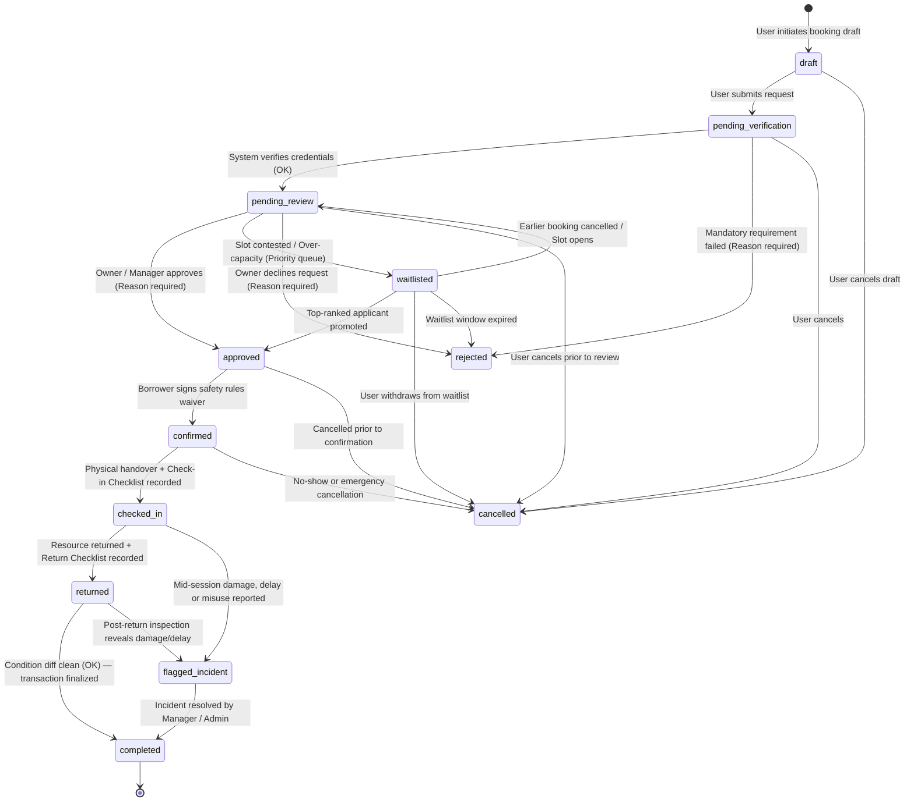

# CampusShare — Booking State Machine & Transition Rules

This document details the complete 10-step lifecycle and state machine for resource bookings in **CampusShare**, as defined in `PROMPTS.md` (Stage 1 Foundation).

Implemented in code at: [`src/lib/rules/state-machine.ts`](../../src/lib/rules/state-machine.ts)

---

## 1. Visual State Machine Diagram

---

## 2. Transition Rules Specification

Every state transition strictly validates three criteria server-side:
1. **Allowed Actors:** Only authorized roles can trigger the state change.
2. **Mandatory Plain-Language Reasons:** Destructive or blocking decisions (`rejected`, `waitlisted`, `cancelled`, `approved`) require a human-readable explanation of **WHY**.
3. **Physical Condition Records:** Handover (`checked_in`) and return (`returned`) require completing inspection checklists.

| From Status | To Status | Allowed Actors | Requires Reason? | Condition Record? | Description & Governance Rules |
| :--- | :--- | :--- | :---: | :---: | :--- |
| `draft` | `pending_verification` | `user`, `admin` | No | None | User submits request for automated prerequisite verification. |
| `draft` | `cancelled` | `user`, `admin` | No | None | User abandons draft. |
| `pending_verification` | `pending_review` | `system`, `user`, `admin` | No | None | Prerequisite verification passed; waiting for human review. |
| `pending_verification` | `rejected` | `system`, `owner`, `manager`, `admin` | **Yes** | None | User lacks mandatory qualifications or credentials expired. |
| `pending_review` | `approved` | `owner`, `manager`, `admin` | **Yes** | None | Owner approves slot. Plain-language reason displayed to borrower. |
| `pending_review` | `waitlisted` | `owner`, `manager`, `admin` | **Yes** | None | Slot has conflicting demand; borrower ranked on fair-share queue. |
| `pending_review` | `rejected` | `owner`, `manager`, `admin` | **Yes** | None | Request declined with transparent explanation. |
| `waitlisted` | `approved` | `owner`, `manager`, `admin` | **Yes** | None | Promoted to approved when higher booking cancels. |
| `approved` | `confirmed` | `user`, `admin` | No | None | Borrower confirms booking and digitally acknowledges safety rules. |
| `confirmed` | `checked_in` | `owner`, `manager`, `admin`, `user` | No | **check_in** | Physical handover complete. Initial checklist items recorded (`ok`, `minor_issue`, `damaged`). |
| `checked_in` | `returned` | `owner`, `manager`, `admin`, `user` | No | **return** | Resource returned. Final checklist recorded for diff comparison. |
| `checked_in` | `flagged_incident` | `owner`, `manager`, `admin`, `user` | **Yes** | None | Mid-booking issue reported (damage, late return, or safety violation). |
| `returned` | `completed` | `owner`, `manager`, `admin` | No | None | Inspection diff verified clean. Booking cycle successfully closed. |
| `returned` | `flagged_incident` | `owner`, `manager`, `admin` | **Yes** | None | Condition worsened between check-in and return. Draft incident generated. |
| `flagged_incident` | `completed` | `owner`, `manager`, `admin` | **Yes** | None | Manager reviews incident, records decision notes, and closes case. |

---

## 3. Auditing & Tamper Prevention

Every transition writes an immutable event entry to:
- **`booking_events`:** Human-readable timeline for borrowers and owners.
- **`audit_log`:** SHA-256 cryptographically chained record (`hash = SHA256(prev_hash + canonical_json)`).

